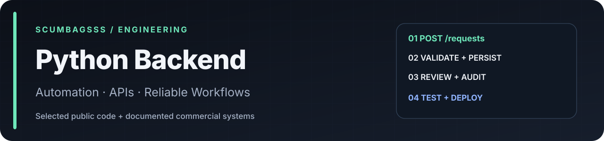

# Scumbagsss
### Python Backend · Automation Engineering

**Turning manual workflows, event streams and external APIs into practical backend tools.**

**[Runnable Python demos](#runnable--verifiable-python)** · **[Visual showcase](VISUAL_SHOWCASE.md)** · **[Commercial case studies](#commercial--private-source-case-studies)** · **[Project index](PORTFOLIO.md)**

---

## Hello

I build Python automation and backend services for community operations, server infrastructure and workflows that need **reliable state, clear audit trails and useful integrations**.

My work includes asynchronous Discord applications, REST API consumers, SQLite-backed services, log/event analysis and staff approval systems.

This portfolio separates **verifiable public code** from **documented commercial projects**. There is no claim that private-source demonstrations can be installed from their public skeletons.

## Runnable & verifiable Python

These are independently runnable **synthetic demonstrations** with no live Discord credentials, customer data or private production logic.

| Project | What you can inspect | Verification |
|---|---|---|
| **[Ticket Workflow Backend](https://github.com/Scumbagsss/advanced-discord-ticket-bot)** | SQLite storage, state transitions, staff permissions, audit history, HTML export | [CI](https://github.com/Scumbagsss/advanced-discord-ticket-bot/actions/workflows/python-demo.yml) · 21 unit tests |
| **[Server Monitoring Pipeline](https://github.com/Scumbagsss/dayz-server-monitor-bot)** | JSONL ingestion, validation, UTC time normalization, atomic SQLite ingestion, daily metrics | [CI](https://github.com/Scumbagsss/dayz-server-monitor-bot/actions/workflows/monitor-demo.yml) · 28 unit tests |
| **[Priority Access REST API](https://github.com/Scumbagsss/priority-access-bot)** | FastAPI, token-authenticated synthetic requests, approval state, transactional local entitlement records | [CI](https://github.com/Scumbagsss/priority-access-bot/actions/workflows/api-demo.yml) · 31 pytest tests |

All three demos support Python 3.11+. The ticket and monitoring examples use only the standard library; the FastAPI API lists its third-party dependencies in `requirements-demo.txt`. All are **synthetic portfolio examples**, not complete commercial deployments.

## Commercial & private-source case studies

| System | Problem solved | Engineering themes |
|---|---|---|
| **[DeadCity Automation Platform](https://github.com/Scumbagsss/BOT)** | Player support, staff tools, moderation and server operations | Discord Cogs, async Python, persistence, integrations, logging |
| **[SpawnSet Activity Investigation](https://github.com/Scumbagsss/spawnset-dupe-detector)** | Review of suspicious game-server activity and log relationships | Event processing, timelines, case state, data quality |
| **[Transport Marketplace](https://github.com/Scumbagsss/dayz-transport-market-bot)** | Moderated listings and reservations | Data modeling and multi-step workflows |

Private projects are described through architecture, case-study documentation and limited interfaces. Sensitive code, player records and credentials remain excluded.

## Technical focus

- **Backend:** Python, asyncio, FastAPI, service boundaries, validation, REST API consumers
- **Data:** SQLite, aiosqlite, MySQL integrations, structured logs, historical snapshots
- **Workflow design:** permissions, approval state, auditability, retry and duplicate-event handling
- **Quality:** unit tests, GitHub Actions, reproducible synthetic examples and clear documentation

## Featured project: DeadCity

The [DeadCity engineering case study](https://github.com/Scumbagsss/BOT/blob/main/docs/CASE_STUDY.md) explains a Discord-integrated operations platform with ticket handling, application review and moderation alerts.

A reviewed private source snapshot included **27 locally passing tests in its activity-investigation subsystem**. This result does not represent full application coverage.

## Collaboration

Open to **Python backend opportunities** and **commercial automation / integrations**.

**Contact:** Discord — `scumbagsss` · Telegram — [@dilarion](https://t.me/dilarion) · [GitHub](https://github.com/Scumbagsss).

<b>По-русски</b>

Разрабатываю Python-системы автоматизации: сервисы с базами данных и API, Discord-интеграции, обработку событий и логов, административные процессы и инструменты для команд. В публичном портфолио есть три запускаемых демопроекта с тестами, а коммерческие проекты представлены как технические кейсы без публикации закрытого кода.

