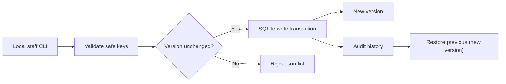

# Visual showcase — Scumbagsss

> **Every image on this page is a synthetic, explanatory SVG.** These are not production screenshots, UI exports, performance measurements, live server records or evidence of a deployed module. They contain only fictional labels and, where stated, fabricated demo fixtures.

## 1. DeadCity — community operations

The [DeadCity portfolio case study](https://github.com/Scumbagsss/BOT) documents support workflows, moderation signals, server-status integration and staff reviews. The [technical review](https://github.com/Scumbagsss/BOT/blob/main/docs/TECHNICAL_REVIEW.md) separates verified archive findings from proposed refactor work.

## 2. Priority access — FastAPI + SQLite

The [runnable REST demo](https://github.com/Scumbagsss/priority-access-bot) uses fictional identities and **local SQLite entitlements only**. Session authentication, staff authorization, duplicate approvals and concurrency are covered by [44 tests](https://github.com/Scumbagsss/priority-access-bot/blob/main/tests/test_api_demo.py). It never calls the commercial access API.

## 3. Ticket lifecycle — local backend

The [runnable ticket backend](https://github.com/Scumbagsss/advanced-discord-ticket-bot) demonstrates persisted states, staff permissions, event history and basic HTML export using invented actors.

## 4. Monitoring — fabricated time-series data

The [runnable monitoring demo](https://github.com/Scumbagsss/dayz-server-monitor-bot) loads the repository's **fictional JSONL fixtures**, not real DayZ history. Its sample-based summary is not an uptime SLA.

## 5. Versioned settings — local SQLite backend

The [runnable configuration service](https://github.com/Scumbagsss/discord-config-manager) demonstrates **optimistic versions, atomic changes, audit events and rollback** with fabricated settings and [36 tests](https://github.com/Scumbagsss/discord-config-manager/blob/main/tests/test_config_demo.py).

No production Discord config, passwords or tokens are loaded by this example.

## 6. Marketplace — conceptual listing flow

The [marketplace case study](https://github.com/Scumbagsss/dayz-transport-market-bot) outlines moderated listings and reservations. [Engineering notes](https://github.com/Scumbagsss/dayz-transport-market-bot/blob/main/docs/ENGINEERING_NOTES.md) explicitly mark the illustrated states as a design model rather than verified production behavior.

---

**Publication boundary:** Real player identifiers, payment details, staff-channel logs and proprietary algorithms are excluded. Commercial screenshots are not published here without the relevant owner's approval and a manual redaction review.

**Contact:** Discord `scumbagsss` · Telegram [@dilarion](https://t.me/dilarion)
